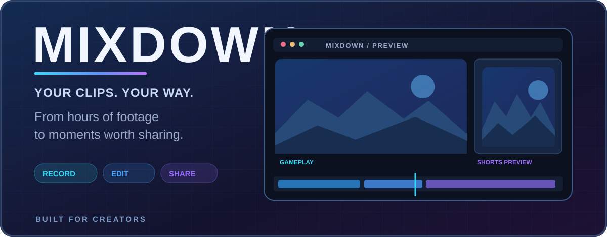
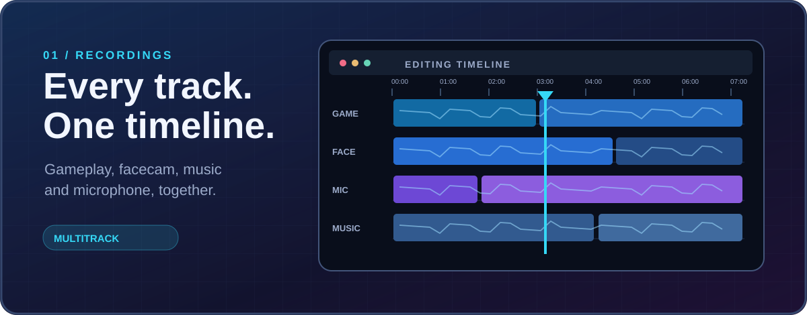
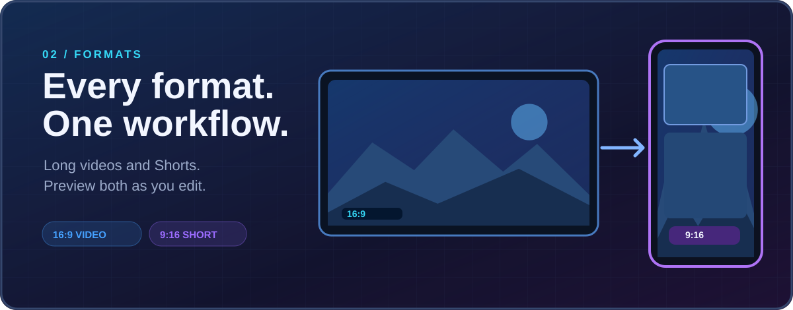
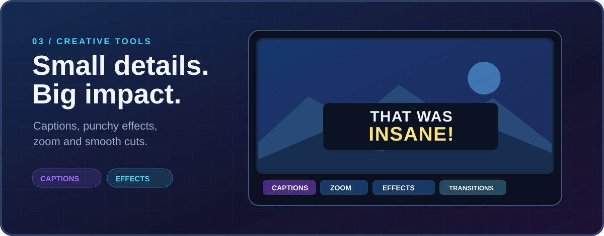
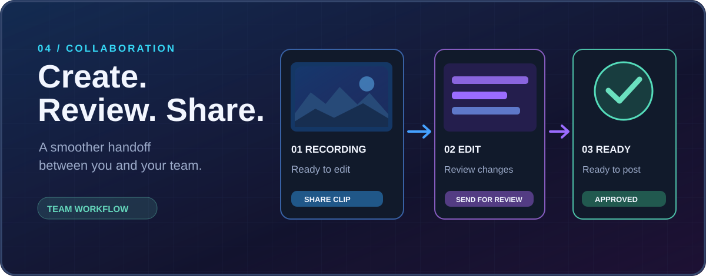

  

<h1 align="center">Mixdown</h1>

<strong>From long recordings to standout clips.</strong> 
The video editor built for streamers, gamers and content creators.

<a href="https://github.com/Znypr/mixdown-releases/releases/latest/download/Mixdown-for-editor.zip"><strong>⬇️ Download for Windows</strong></a> · <a href="https://github.com/Znypr/mixdown-releases/releases/latest">Latest release</a>

---

## Discover Mixdown

### 01 / 🎬 Your recordings, one timeline

Bring gameplay, facecam and individual OBS audio tracks together. Browse long recordings and replays, find the best moments and cut away the rest.

### 02 / 📱 Videos for every screen

Create full-length horizontal videos and vertical Shorts with dedicated previews and flexible layouts.

### 03 / ✨ Give every clip personality

Add animated captions, zooms, transitions, effects and sound. Save your favorite layouts and styles to use again.

### 04 / 🤝 Made for creative teams

Share recordings with your editors, review their cuts, request changes and keep videos organized through publishing.

---

## Get started

**[Download Mixdown for Windows →](https://github.com/Znypr/mixdown-releases/releases/latest/download/Mixdown-for-editor.zip)**

Extract the ZIP and run **Mixdown.exe**. You can edit local videos without an account. Team collaboration is optional.

Windows desktop app · By Znypr
